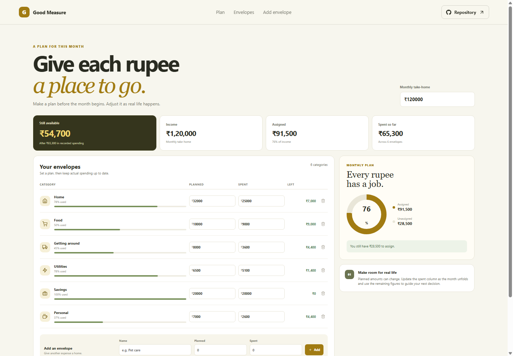

# Good Measure Monthly Budget Planner

Good Measure is a zero-based monthly budget planner. Set take-home income, give it spending categories, and compare each plan with what has actually been spent.

## What it includes

- Editable monthly take-home income.
- Category envelopes with planned and spent amounts.
- Remaining amount and usage status for each category.
- Summary of income, assigned money, recorded spending, and unspent cash.
- A visual split between assigned and unassigned income.
- Add and remove categories with a confirmation step.
- Automatic saving in this browser.

## How to use it

Change Monthly take-home to set the income pool. Edit the Plan and Spent fields for each envelope. The summary and allocation ring respond to each change. Add an envelope for a category that is missing. Remove an envelope only after confirming the action.

## Saving and data

Income and category amounts are saved to local storage in this browser. They do not sync across devices. Starter figures are sample amounts. The planner does not connect to a bank account or import transactions, so update the Spent values yourself.

## Run locally

Run npm install to install dependencies, npm run dev to start the local server, npm run lint and npm run build to check the project, and npm run deploy to publish it to GitHub Pages.

Planned URL after deployment: https://a2rp.github.io/monthly-budget-planner/

## Future improvements

Ideas that are not implemented yet: budget templates, month-to-month comparisons, and scheduled imports from a bank or expense tracker.

## Links

- Portfolio: [https://www.ashishranjan.net](https://www.ashishranjan.net)
- GitHub: [https://github.com/a2rp](https://github.com/a2rp)
- CodePen: [https://codepen.io/ash1198](https://codepen.io/ash1198)
- LinkedIn: [https://www.linkedin.com/in/aashishranjan](https://www.linkedin.com/in/aashishranjan)
- Facebook: [https://www.facebook.com/theash.ashish/](https://www.facebook.com/theash.ashish/)
- YouTube: [https://www.youtube.com/@ashishranjan-ashz?sub_confirmation=1](https://www.youtube.com/@ashishranjan-ashz?sub_confirmation=1)
- Email: [mailto:ash.ranjan09@gmail.com](mailto:ash.ranjan09@gmail.com)

## Support

- Support: [https://a2rp-donation-page.netlify.app/](https://a2rp-donation-page.netlify.app/)
- Buy Me a Coffee: [https://buymeacoffee.com/ashishranjan](https://buymeacoffee.com/ashishranjan)
- Patreon: [https://www.patreon.com/ashishranjan](https://www.patreon.com/ashishranjan)